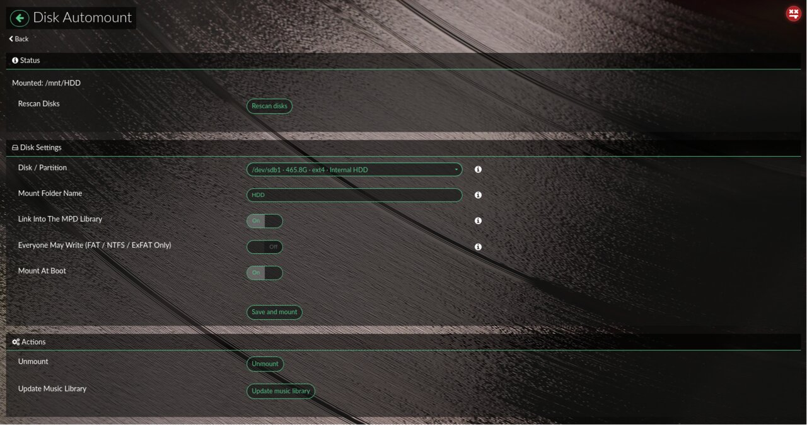
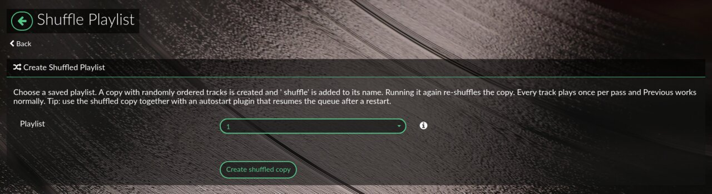
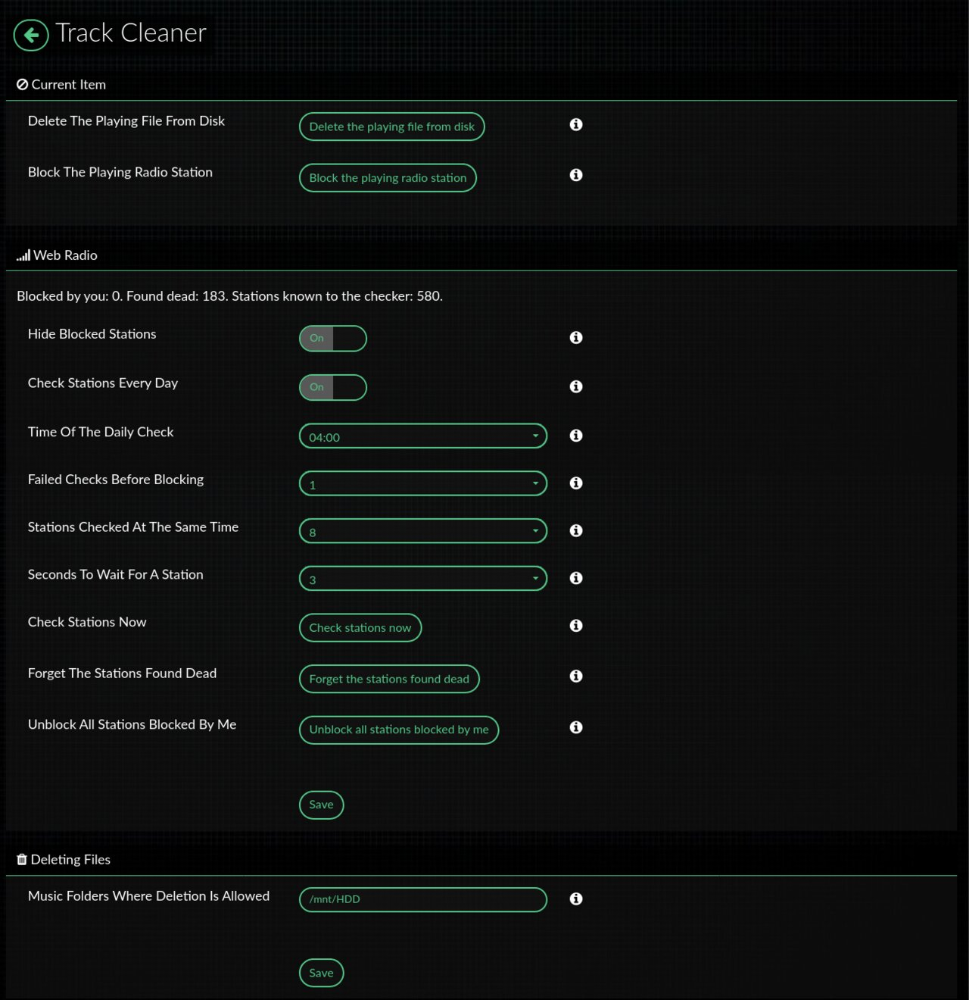
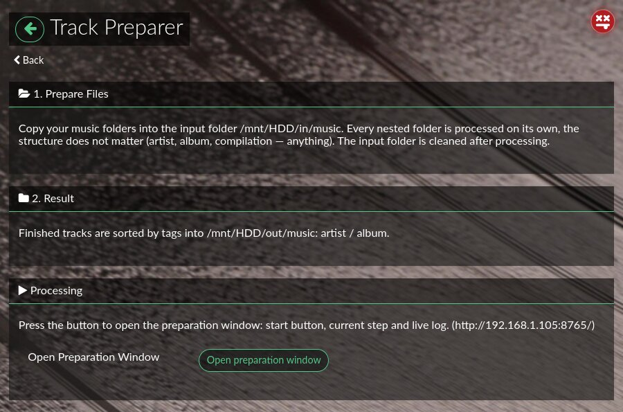
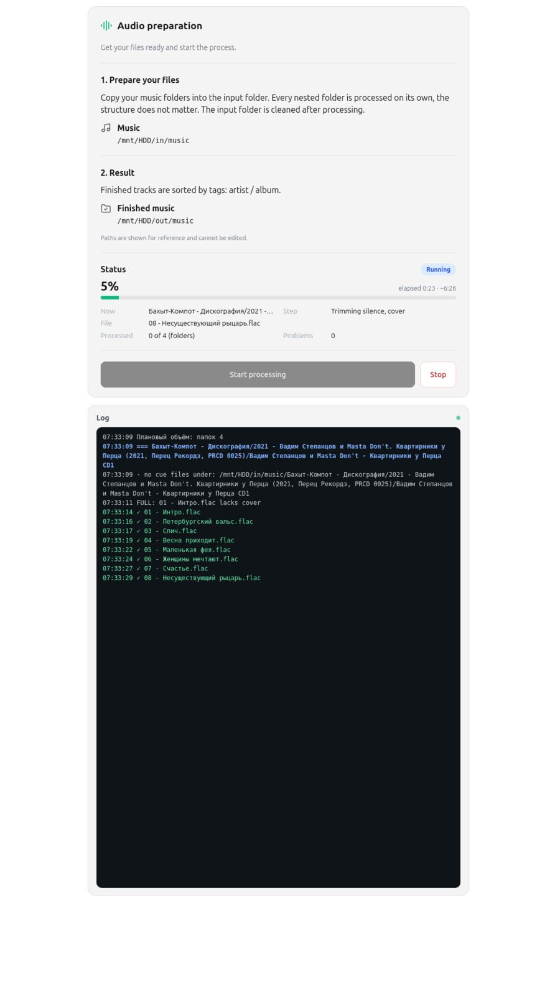
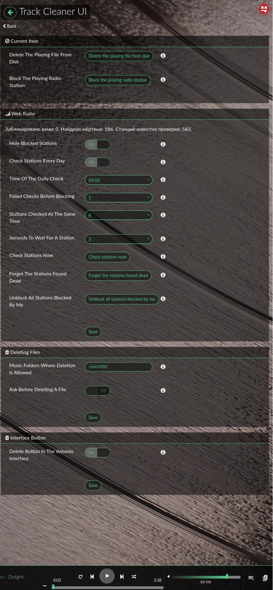

# Unofficial Volumio Plugins

[🇬🇧 English](README.md) | [🇷🇺 Русский](README.ru.md)

Plugins for **Volumio 4 (Bookworm)**, `amd64` and `armhf`, Node 20.

Disk Automount, Shuffle Playlist, Track Cleaner and Track Preparer are also submitted
to the official [volumio-plugins-sources-bookworm](https://github.com/volumio/volumio-plugins-sources-bookworm)
repository and will appear in the plugin store after review.

---

## Disk Automount — 1.0.0

Keeps Volumio on a flash drive or SD card and your music on a separate internal, SATA
or NVMe disk. The disk is selected by UUID, mounted at boot by a small systemd service
and linked into the MPD library. Reinstalling Volumio never touches the music disk.



## Shuffle Playlist — 1.0.4

Creates a shuffled copy of any saved playlist and adds ` shuffle` to its name. Every
track plays once per pass, so nothing repeats and the **Previous** button works
normally. The original playlist is not changed.



## Track Cleaner — 1.0.5

Keeps web radio lists tidy. One button blocks the playing station, a daily check reads
the radio screen by itself, finds stations that no longer deliver a stream and hides
them, and brings them back when they come alive. A second button deletes the playing
music file from disk, only inside the folders you allow.



## Track Preparer — 1.9.0

Takes a folder of unsorted music and returns clean, tagged files in a second folder:
unpacks archives, splits CUE + image albums, converts formats to FLAC or MP3, trims
silence, embeds covers, merges multi-disc albums (including discs marked in the album
name, such as `Album CD2`), sorts everything into `Artist/Album` by tags and writes
ReplayGain track gain. Files are moved, not copied: the input folder is emptied as
albums are finished. A progress page is served on the local network.

ReplayGain has to be switched on in MPD, otherwise the tags are ignored. Volumio keeps
this setting in a config file that belongs to its own MPD plugin, so it cannot be done
from the plugin; use the helper script instead: `sudo bash tools/enable-replaygain.sh`
(`--dry-run` to preview, `--restore` to roll back). Details in
[track_preparer/README.md](track_preparer/README.md#switching-replaygain-on-in-mpd).





## Track Cleaner UI — 1.0.8 (experimental, not for the store)

The same as Track Cleaner plus a delete icon in the Volumio web interface, to the
right of the search field, on every screen.

> **It patches `index.html` in `/volumio/http`**, which the official repository does
> not allow, so this plugin is not submitted to the store. Use it at your own risk,
> disable it before a Volumio update and do not run it together with Track Cleaner.



---

## Installation (SSH)

```bash
git clone https://github.com/karkolom223/volumio_plugin.git
cd volumio_plugin

cd disk_automount     && volumio plugin install && cd ..
cd shuffle_playlist   && volumio plugin install && cd ..
cd track_cleaner      && volumio plugin install && cd ..
cd track_preparer     && volumio plugin install && cd ..
```

After installation open **Settings → Plugins → Installed plugins**, enable the plugin
and open its settings.

From an archive: unzip it, `cd` into the folder and run `volumio plugin install`.

## Requirements

- Volumio 4.x (Debian 12 "Bookworm"). These packages are not for Volumio 3.
- `amd64` (x86) or `armhf` (Raspberry Pi and similar).
- Track Preparer installs `ffmpeg`, `flac`, `python3-pil` and `python3-mutagen` through
  `apt` if they are missing; everything else has no system dependencies.

## License

Every plugin is released under the MIT license; each plugin folder has its own `LICENSE` file.
