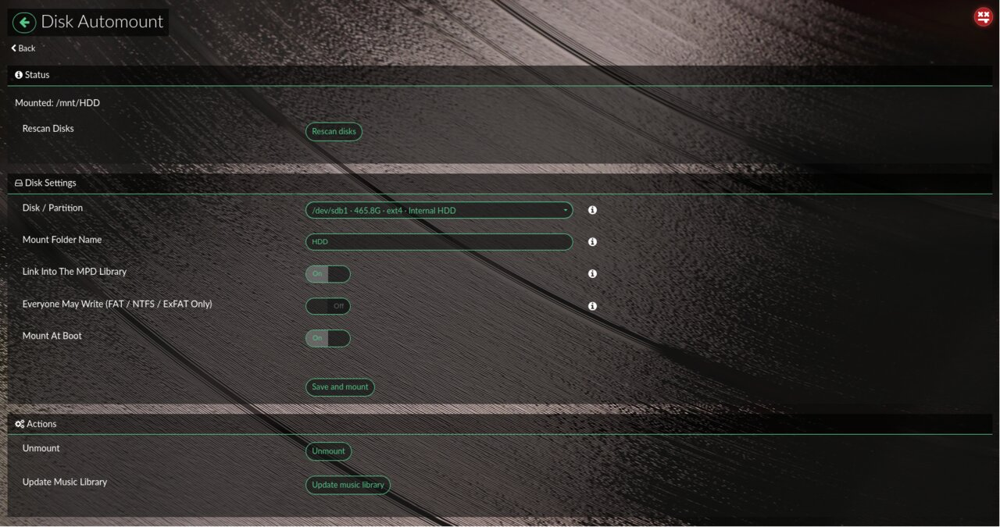
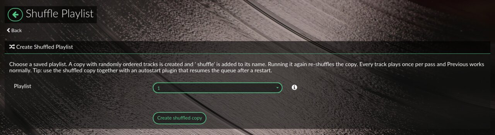
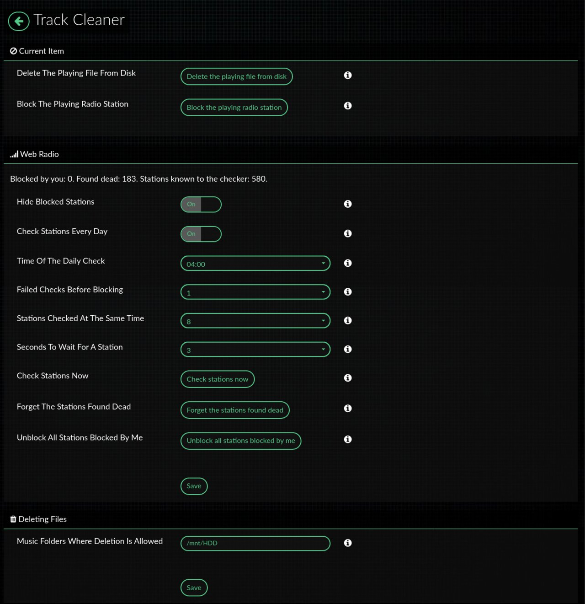
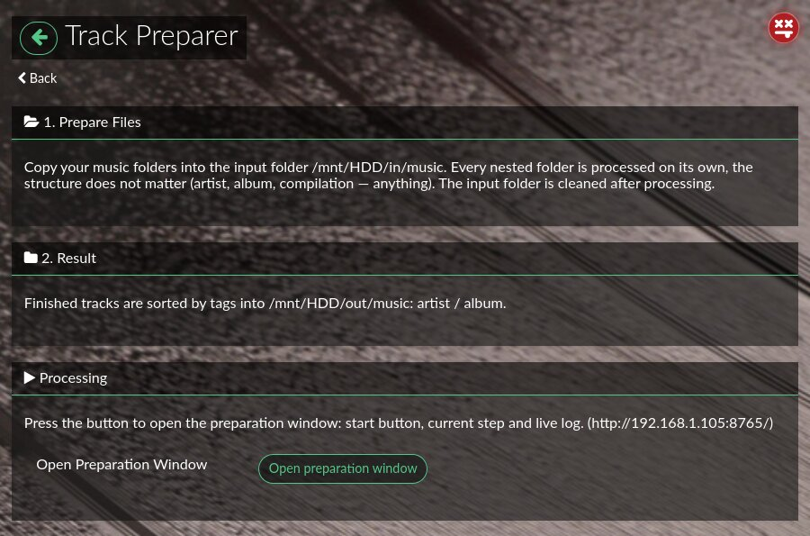
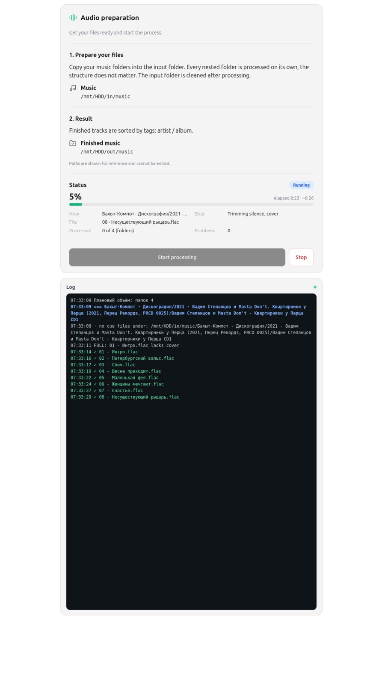
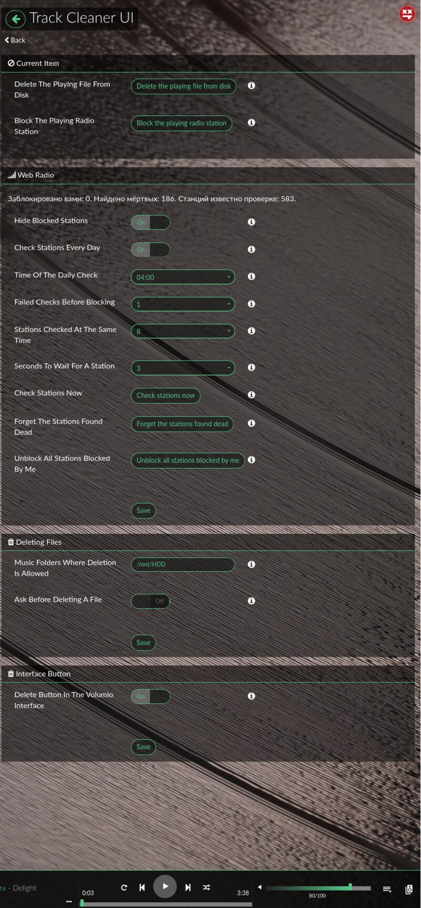

# Неофициальные плагины для Volumio

[🇬🇧 English](README.md) | [🇷🇺 Русский](README.ru.md)

Плагины для **Volumio 4 (Bookworm)**, `amd64` и `armhf`, Node 20.

Disk Automount, Shuffle Playlist, Track Cleaner и Track Preparer также отправлены в
официальный репозиторий [volumio-plugins-sources-bookworm](https://github.com/volumio/volumio-plugins-sources-bookworm)
и появятся в магазине после проверки.

---

## Disk Automount — 1.0.0

Volumio на флешке или SD-карте, музыка — на отдельном внутреннем диске, SATA или NVMe.
Диск выбирается по UUID, монтируется при загрузке небольшим systemd-сервисом и
подключается к библиотеке MPD. Переустановка Volumio музыку не трогает.



## Shuffle Playlist — 1.0.4

Создаёт перемешанную копию любого сохранённого плейлиста и добавляет к названию
` shuffle`. Каждый трек играет один раз за проход, повторов нет, кнопка **Назад**
работает как обычно. Исходный плейлист не изменяется.



## Track Cleaner — 1.0.5

Поддерживает порядок в веб-радио. Одна кнопка блокирует играющую станцию, ежедневная
проверка сама читает экран радио, находит станции, которые больше не отдают поток, и
прячет их, а вернувшиеся показывает снова. Вторая кнопка удаляет играющий музыкальный
файл с диска — только внутри разрешённых папок.



## Track Preparer — 1.9.0

Берёт папку с неразобранной музыкой и возвращает аккуратные размеченные файлы во второй
папке: распаковывает архивы, режет образы CUE, конвертирует форматы в FLAC или MP3,
обрезает тишину, встраивает обложки, объединяет многодисковые альбомы (включая диски с
меткой в названии, например `Альбом CD2`), раскладывает всё по `Артист/Альбом` по тегам
и записывает ReplayGain. Файлы переносятся, а не копируются: входная папка по мере
работы очищается. Окно с ходом работы открывается по сети.





## Track Cleaner UI — 1.0.8 (экспериментальный, не для магазина)

То же, что Track Cleaner, плюс иконка удаления в веб-интерфейсе Volumio справа от поля
поиска, на всех экранах.

> **Плагин правит `index.html` в `/volumio/http`**, чего официальный репозиторий не
> разрешает, поэтому в магазин он не отправляется. Используйте на свой риск,
> отключайте перед обновлением Volumio и не включайте вместе с Track Cleaner.



---

## Установка (SSH)

```bash
git clone https://github.com/karkolom223/volumio_plugin.git
cd volumio_plugin

cd disk_automount     && volumio plugin install && cd ..
cd shuffle_playlist   && volumio plugin install && cd ..
cd track_cleaner      && volumio plugin install && cd ..
cd track_preparer     && volumio plugin install && cd ..
```

После установки: **Настройки → Плагины → Установленные плагины**, включить плагин и
открыть его настройки.

Из архива: распаковать, зайти в папку и выполнить `volumio plugin install`.

## Требования

- Volumio 4.x (Debian 12 «Bookworm»). Эти пакеты не для Volumio 3.
- `amd64` (x86) или `armhf` (Raspberry Pi и подобные).
- Track Preparer при необходимости ставит через `apt` пакеты `ffmpeg`, `flac`,
  `python3-pil`, `python3-mutagen`; у остальных плагинов системных зависимостей нет.

## Лицензия

Все плагины распространяются по лицензии MIT; в каждой папке плагина свой файл `LICENSE`.
